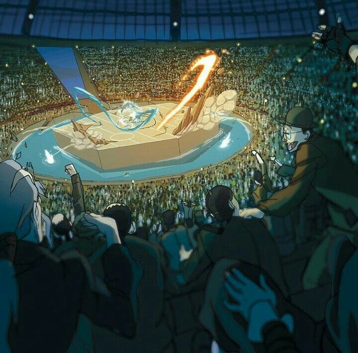

# The Academy Arena — Visual Design Reference

`reference.jpg` is the target look for the **Academy Arena**, the venue where
the **Bouts** take place. It is a mood/layout reference only; the architecture
below is what our version must reproduce.

Focus areas, in priority order: **(1) the large sunken stadium** and
**(2) the moat surrounding the elevated arena**. The fighters, effects and
foreground crowd in the reference are secondary.

## 1. The sunken stadium (primary)

The arena sits at the bottom of a huge bowl. Spectators look *down* onto the
fight from every side.

- **Shape:** a vast, roughly circular/oval bowl sunk below the surrounding
  ground level. The floor of the bowl is the lowest point of the building.
- **Seating:** continuous, steeply raked tiers rising from the moat's edge all
  the way to the roofline, wrapping 360°. No breaks except entrance tunnels.
- **Scale:** the stands must dwarf the platform — tens of thousands of
  spectators. Read the crowd as a dense, glittering texture, not individuals,
  beyond the first few rows.
- **Tier ring:** a low parapet/rail band (deep red-brown in the reference)
  separates the lowest seats from the moat apron.
- **Roof:** a domed or vaulted roof of dark ribbed panels (steel-and-glass
  feel), with large structural ribs radiating toward the centre and small
  point lights studded along them. Night-sky blue tones through/behind it.
- **Entrance:** at least one large angled ramp/gantry cutting through the
  stands down toward the arena (upper-left in the reference), lit from within.
- **Camera/vantage:** the hero shot is from high in the stands, looking down
  at about 30–40°, with silhouetted spectators in the foreground framing the
  bowl.

## 2. The moat and elevated arena (primary)

- **Platform:** a raised, flat, **octagonal** fighting stage in the dead
  centre of the bowl. Sheer vertical sides, pale sandstone/tan, standing
  clearly above the water (roughly 1.5–2× a person's height).
- **Playing surface:** marked with thin lines dividing it into zones — a
  centre line splitting two halves, with further lines/rings marking
  sub-zones in each half (advance/retreat zones for the Bouts).
- **Moat:** a ring of water completely encircling the platform, following its
  octagonal outline but with a softly rounded outer edge.
  - Colour: bright cyan/turquoise, visibly glowing — it should be one of the
    brightest elements in the scene and light the platform's base from below.
  - Width: wide enough that a fighter knocked off the platform lands in the
    water, not on the stands (about half the platform's radius).
  - Outer edge: a smooth, light stone lip/apron, then the parapet and stands.
- **Interaction:** the water is a game element — fighters knocked out of the
  ring fall into the moat; splashes and spray should be visible on impact.
- **Damage:** the platform surface can be broken up — slabs and rock spikes
  erupting from the floor, debris thrown into the moat.

## Palette

| Role                  | Approx. color | Hex       |
|-----------------------|---------------|-----------|
| Roof / night shadow   | Deep navy     | `#14243A` |
| Crowd mass (base)     | Dark teal     | `#1F3B3A` |
| Crowd highlights      | Warm gold     | `#C9B86A` |
| Parapet ring          | Brick red     | `#7A3A2A` |
| Platform stone        | Sandy tan     | `#D8BE8E` |
| Platform shadow side  | Ochre         | `#A88A5A` |
| Moat water            | Glowing cyan  | `#5FD6E8` |
| Moat highlight / foam | Ice white     | `#E8FBFF` |
| Fire effect accent    | Flame orange  | `#FF8A2A` |

## Lighting & mood

- Night event under the roof. Overall scene is dark teal/navy; **the arena and
  moat are the light source** — a pool of warm light on the platform and a
  cool cyan glow from the water.
- Thousands of tiny camera-flash / lantern sparkles scattered through the
  stands.
- Foreground spectators rendered as dark silhouettes, cheering, arms raised.
- Feeling: electric, packed, high-stakes championship night.

## Composition notes

- Near-square framing for the hero shot; the platform sits slightly above
  centre.
- Contrast hierarchy: moat (brightest) → platform → crowd sparkles → dark
  stands → silhouetted foreground.
