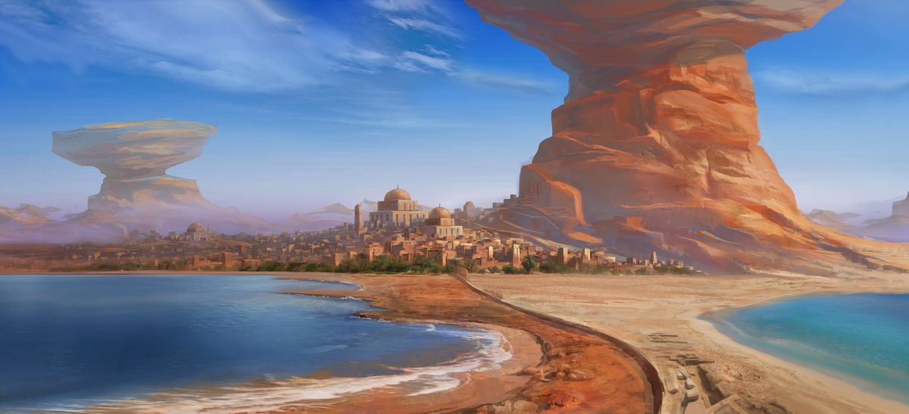

# The Arrowhead — Visual Design Reference

**The Arrowhead is an original design.** `reference.jpg` sets the setting,
palette and mood, but it is **missing the city's defining landmark**: the
giant arrowhead jutting out of the ground that the city is named for. All art
for The Arrowhead must add it as described in
[The Arrowhead landmark](#the-arrowhead-landmark) below.

## Setting

A sun-baked desert port city on a sandy coast, built at the foot of a
colossal wind-carved sandstone pillar. Rising from the heart of the city is
a titanic obsidian arrowhead, driven point-first into the earth at an angle.
It is the head of a real arrow, fired and fallen from the sky, its base buried and its broad blade and tang jutting
high above the rooftops. The city takes its name from it. Two bays of water
frame a narrow spit of land that leads straight toward the city.

## The Arrowhead landmark

The single most important element of any depiction of the city. Nothing in
the reference image shows it; it must be added.

**Lore:** the Arrowhead is the head of an arrow that was fired and fell from
the sky. On its way down it split the mountain range in two, carving out
**Death Valley** (see [`../death-valley/`](../death-valley/README.md)), before
burying itself point-first where the city now stands.

- **Form:** a classic knapped stone arrowhead (leaf/triangular blade with
  notched shoulders and a short tang), **point buried in the ground**. Roughly
  the bottom third of the blade is underground; the wide shoulders and tang
  are exposed and point up and back toward the sky.
- **Angle:** tilted ~20–30° from vertical, as if it struck the earth on a
  steep descent. The tang leans back toward the direction it came from —
  the mountain range and Death Valley — so its line of flight is readable. The tilt should read clearly
  against the near-vertical rock pillar.
- **Scale:** taller than the great domed palace by several times and at least
  as tall as the waist of the rock pillar — visible from anywhere on the
  coast. It is the city's skyline focal point, not a monument on a plinth.
- **Placement:** in or just behind the city centre, between the domed palace
  and the rock pillar, so the causeway leads the eye straight to it.
- **Material & surface:** **obsidian** — dark, glassy knapped volcanic glass,
  deep charcoal with a blue-violet sheen, to contrast with the warm sandstone
  around it. Conchoidal flake scars across both faces; sharp, faintly
  catching edges. Weathered and dusty near the ground.
- **Impact:** the ground around its base is heaved up in a broken crater rim
  of cracked rock and sand, which the city has built over and into —
  terraces, stairs and buildings follow the buckled ground.
- **Integration with the city:** buildings cluster against its base; its
  shadow falls across part of the city. Small figures, banners or walkways
  on the lower exposed blade help sell the scale.

Open questions to confirm: its exact position relative to the rock pillar,
and where Death Valley lies relative to the city (so the arrow's line of
flight, and the tang's lean, point the right way).

## Key elements (in order of visual importance)

0. **The Arrowhead** — see the section above. Dominant focal point.
1. **The great rock pillar** (right third of frame) — an enormous
   hoodoo/mesa of layered red-orange sandstone. Narrow at the waist,
   flaring into a wide overhanging cap that runs off the top of the frame.
   The city climbs up its lower slopes.
2. **The city** (center, mid-ground) — dense, low, flat-roofed mud-brick and
   sandstone buildings in warm tan/ochre. Skyline accents:
   - a large central domed palace/temple on a raised terrace,
   - a second, smaller dome just right of it,
   - a few slim square towers / minarets,
   - terraced structures carved into the base of the pillar.
3. **The causeway** — a curved stone wall/road running from the foreground
   up to the city, separating the two bays. Stone steps and ruins at its
   lower right edge.
4. **Two bays**
   - Left: large, deep blue bay with white surf breaking on a red-sand beach.
   - Right: smaller, shallow turquoise lagoon with pale sand shores.
5. **Oasis greenery** — a band of palms and green shrubs along the city's
   waterfront edge, the only vegetation in the scene.
6. **Distant pillar** (left background) — a second, smaller mushroom-shaped
   rock formation, hazy and desaturated from atmospheric perspective.
7. **Background** — low hazy desert mesas along the horizon.

## Palette

| Role               | Approx. color | Hex       |
|--------------------|---------------|-----------|
| Sky (top)          | Deep blue     | `#2F6FC4` |
| Sky (horizon haze) | Pale lavender | `#B9C3DD` |
| Rock highlight     | Burnt orange  | `#D9773F` |
| Rock shadow        | Rust brown    | `#8A3F24` |
| City stone         | Sandy ochre   | `#C9A27A` |
| Beach sand         | Warm beige    | `#E3C9A3` |
| Red sand / path    | Terracotta    | `#B5603A` |
| Deep bay           | Ocean blue    | `#2D5D9A` |
| Lagoon             | Turquoise     | `#3FB7C9` |
| Surf               | Off-white     | `#F2EEE8` |
| Palms              | Olive green   | `#4C6B2E` |
| Arrowhead stone    | Obsidian      | `#22232E` |
| Arrowhead sheen    | Blue-violet   | `#5A5F8C` |

## Mood & lighting

- Bright, clear midday sun from the left; strong warm light on the rock
  faces, cool blue shadows.
- Wispy high cirrus clouds; very open, airy sky occupying ~half the frame.
- Painterly, slightly stylized concept-art finish — not photoreal.
- Feeling: ancient, prosperous, welcoming trade city; grand scale from the
  pillar dwarfing the town.

## Composition notes

- Wide panoramic framing (~2.2:1).
- Horizon sits just below the vertical center.
- The causeway acts as the leading line from the bottom-center into the city
  and on to the Arrowhead.
- The Arrowhead's diagonal is the strongest line in the frame; keep it clear
  of the pillar's silhouette so both read separately.
- The giant pillar anchors the right; the distant pillar balances the left.
