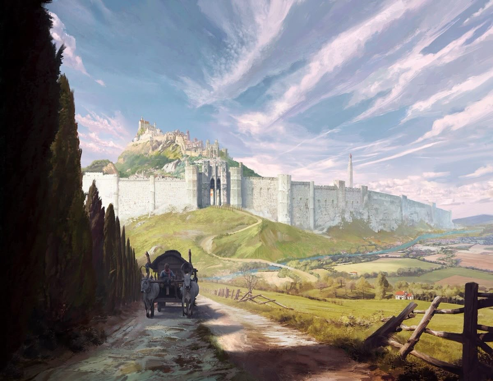
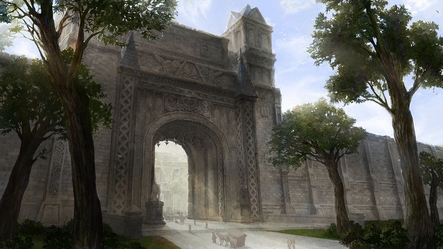

# The Great Gate & the Breach — Visual Design Reference

## Names and place in the world

- **The Great Gate** is the gate itself: the grand entrance through the wall.
- **The Breach** is the town on the far side of the Great Gate. Its full
  name is **the Breach of Civilization**; locals and travellers just call it
  "the Breach". It is an unofficial name, not the town's formal title.
- The Breach is **the very first town travellers reach after leaving the
  Wildlands of the West**. The wall marks the edge of the Wildlands, and
  passing through the Great Gate is the traveller's first step back into
  civilization.
- The approach shown below is therefore from the **west**, coming in from the
  Wildlands side, with the Breach lying beyond the gate to the east.
- Travellers (including Jaun) reach this approach by crossing **Death
  Valley**, the pass through the mountains between the Wildlands and the
  Breach (see [`../death-valley/`](../death-valley/README.md)).
- The farmland outside the wall is a **buffer zone the Breach cleared** out of
  the Wildlands. It should look tamed and cultivated, but it is a frontier:
  the wilder land begins where the farms end.

## The Breach and its people

- **The Citadel on the Hill** is part of the Breach. It is where the town's
  ruling family lives, and the seat of power over the town.
- The ruling family is now the **Yikiza clan**.
- The Breach is mostly made up of **liars, thieves and merchants**. Behind
  the grand, welcoming gate, the town should feel busy, mercantile and a
  little crooked: crowded market streets, haggling stalls, back alleys,
  watchful faces. The contrast between the noble Great Gate and the shady
  town behind it is deliberate.

This brief covers how the Great Gate, and the Breach behind it, must look to
someone approaching. Two references cover the two stages of the approach:

| Stage | Reference | What it sets |
|-------|-----------|--------------|
| Distant approach |  | Setting, scale of the wall, road, gatehouse silhouette |
| Near approach |  | Gate architecture, carving, materials, the view through the arch |

## 1. Distant approach (`approach-distant.jpg`)

The traveller's first full view of the gate, from the farm road below.

- **The road:** a rutted dirt cart track in the foreground, lined on one side
  by a tall dark row of cypress trees and on the other by a broken split-rail
  fence. Ox carts and travellers use it. It winds down, crosses a stream,
  then switchbacks up a grassy hill to the gate.
- **The wall:** a massive, pale limestone curtain wall running
  horizontally across most of the frame, far longer than it is tall. Plain
  ashlar masonry, crenellated top, studded with square and round towers at
  regular intervals. It follows the hill's ridge and fades into haze on the
  right.
- **The Great Gate:** the clear focal point on the wall, set at the top of
  the road's climb. A tall, darker gatehouse that rises above the wall, with
  twin towers flanking a deep central arch (portcullis/doors visible),
  framed by taller corner towers. It reads as more ornate and heavier than
  the plain wall either side.
- **The Breach beyond:** a rocky hill rises behind the gate, crowned by the
  **Citadel on the Hill** (seat of the Yikiza clan), with towers and terraced buildings tumbling down its slopes.
  A lone slender spire/tower stands further along the wall to the right.
- **The landscape:** green rolling hills, a winding blue river, patchwork
  farmland, scattered trees and red-roofed farmhouses fading into distant
  blue mountains.
- **Sky:** huge and dramatic, over half the frame — sweeping diagonal
  streaks of white-pink cirrus on soft blue. Late-afternoon light from the
  right-back, casting long cool shadows across the road.

## 2. Near approach (`approach-near.jpg`)

What the gate looks like once you arrive at its foot.

- **Scale:** the arch is many storeys tall; carts, horses and people at its
  base are tiny. The gate fills the frame and is viewed looking slightly up.
- **The arch:** a single, very tall, deep round-headed arch with a heavy
  recessed frame. Through it you glimpse a bright, hazy plaza and
  pale buildings of the Breach beyond — light pouring out of the opening.
- **Ornament:** elaborate carved stonework over the whole façade —
  interlaced/braided knotwork bands running up the flanking pilasters, a
  sculpted panel and crest above the arch, carved frieze bands, and tall
  narrow tracery windows set into the wall either side.
- **Turrets:** slender pointed pinnacles/spirelets crown the pilasters on
  each side of the arch; behind and above, a square tower with tall lancet
  windows and a steep pointed roof.
- **Statue:** a figure on a pedestal stands just inside / beside the
  entrance.
- **Materials:** weathered grey-brown stone with moss and age staining,
  darker and more detailed than the plain wall seen from afar. The wall
  continues either side as large regular blocks with pilasters.
- **Surroundings:** a paved road leading straight into the arch, flanked by
  tall shade trees and lawns; dappled sunlight and soft atmospheric haze.

## Consistency between the two views

The two references differ; our Great Gate must reconcile them:

- From afar, the gate is the **dark, ornate centrepiece** on an otherwise
  plain, pale wall — that contrast is what makes it readable at distance.
- Up close, it resolves into the **single giant carved arch** with braided
  pilasters, crest panel and pinnacles of the near reference. Treat the
  distant gatehouse's twin towers as the flanking pilaster turrets and the
  tall rear tower seen in the near view.
- The wall itself stays plain limestone ashlar with towers in both views; all
  the decoration is concentrated on the gate.
- The approach road arrives head-on at the arch in both.

## Palette

| Role                  | Approx. color   | Hex       |
|-----------------------|-----------------|-----------|
| Sky                   | Soft blue       | `#8FB3DA` |
| Cirrus clouds         | Pink-white      | `#F1E3EA` |
| Curtain wall          | Pale limestone  | `#DCD8CC` |
| Wall shadow           | Cool grey       | `#9EA3A8` |
| Gate stone            | Weathered taupe | `#7D7468` |
| Gate shadow / carving | Dark umber      | `#4A443D` |
| Hills / grass         | Spring green    | `#8DAA4E` |
| Cypress trees         | Near-black green| `#1E2A1A` |
| River                 | Teal blue       | `#5FA3B5` |
| Dirt road             | Dusty ochre     | `#B9A27E` |

## Mood

Grand, welcoming and ancient. For a traveller coming out of the Wildlands,
the Great Gate is the first sign of civilization in a long time: the
feeling on arrival is relief and awe at the scale and craftsmanship, with
the bright streets of the Breach glimpsed through the arch as the reward.
That first impression is a little too good: inside, the town belongs to
liars, thieves and merchants.
