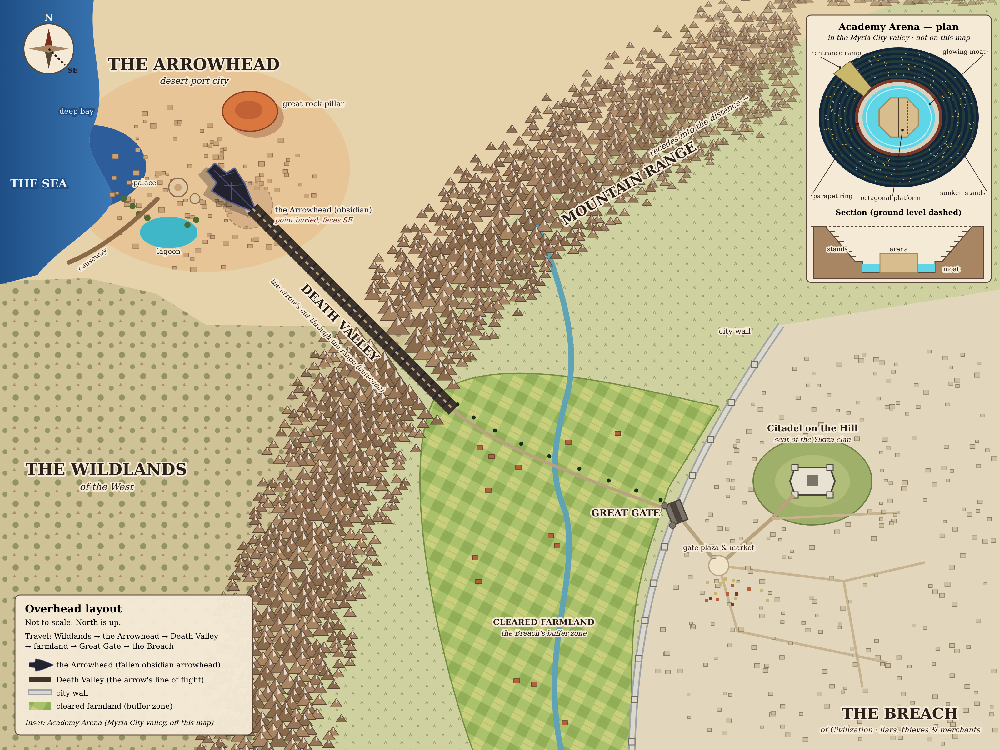

# World Layout — The Arrowhead to the Breach

Overhead map of everything designed so far, from the Arrowhead on the west
coast to the Breach on the far side of the mountains. Not to scale; north is
up.

| File | What it is |
|------|------------|
| `overhead-layout.png` | Rendered map (3200 × 2400). |
| `overhead-layout.svg` | Vector source of the map. |
| `make_overhead_layout.py` | Script that writes the SVG. Edit this, not the SVG. |

To regenerate: run `python3 design/world/make_overhead_layout.py`, then
render the SVG to PNG at 2× (any SVG renderer works; the current PNG was made
with headless Chromium).

## The big picture

The world on this map is defined by a single event: an arrow fired from
somewhere far away fell from the sky heading **southeast**. On the way down it
sliced straight through a mountain range, carving **Death Valley**, and
buried its head point-first in the coast, where it still stands. That head is
**the Arrowhead**, a giant obsidian arrowhead jutting out of the ground, and
the port city around it took its name.

The Arrowhead points southeast into the range, which runs northeast to
southwest and **recedes into the distance** to the northeast. Everything
west of the range is the **Wildlands of the West**. On the range's far side,
straight down the arrow's line of flight, lies **the Breach**.

Travel order for someone heading east, including Jaun:

> Wildlands of the West → the Arrowhead → Death Valley (cutscene) → cleared
> farmland → Great Gate → the Breach

## Places, west to east

### The sea and the coast
Open sea along the west edge. A deep bay and a shallow turquoise lagoon frame
the causeway that leads up into the Arrowhead from the southwest. Full visual
brief: [`../arrowhead/`](../arrowhead/README.md).

### The Arrowhead (desert port city)
- **The landmark:** the obsidian arrowhead at the heart of the city, point
  buried, tang leaning back to the northwest, tip facing **southeast** into
  the mountains. A broken crater rim surrounds the buried point, and the city
  is built over and into it.
- **The city:** dense, flat-roofed sandstone buildings around the Arrowhead,
  the domed palace on the waterfront side, palms along the shore.
- **The great rock pillar:** the colossal sandstone hoodoo just north of the
  Arrowhead (shown overhead as its wide cap and shadow).
- The city sits on the **northern edge of the Wildlands**, and is the last
  settlement before the mountains.

### The Wildlands of the West
The wild, untamed country south and west of the Arrowhead, between the coast
and the mountain range. The Breach's wall and Great Gate mark its official
end; the cleared farmland in between is a frontier.

### The mountain range
Runs northeast to southwest, bowing around the Arrowhead. Its peaks get
smaller and paler toward the northeast to show it receding into the
distance. It is the barrier between the Wildlands and civilization, and the
only way through on this map is Death Valley.

### Death Valley (cutscene)
A dead-straight cut through the range along the arrow's line of flight,
starting at the Arrowhead's tip and running southeast until it opens onto the
farmland. Sheer, sliced walls, a barren floor, glints of obsidian where the
arrow scorched the rock. Full brief: [`../death-valley/`](../death-valley/README.md).

### Cleared farmland (the buffer zone)
Where Death Valley opens out, the Breach has cleared a wide fan of the
Wildlands into patchwork fields, farmhouses and a river. The farm road runs
from the valley mouth, lined with cypress trees, crosses the river, and climbs
to the Great Gate. It should look tamed, but it is a frontier: the wild
begins where the fields end.

### The Great Gate and the city wall
A long, plain limestone curtain wall with towers runs north to south along
the Breach's western edge. The Great Gate is the one dark, ornate gatehouse on
it, where the farm road arrives head-on. Full brief:
[`../great-gate/`](../great-gate/README.md).

### The Breach (the Breach of Civilization)
The first town travellers reach after leaving the Wildlands, and the reason
the wall exists. It is home to **liars, thieves and merchants**.
- **Gate plaza and market:** just inside the Great Gate, a plaza crowded with
  stalls, where the town's main streets branch off. Busy, mercantile and a
  little crooked.
- **The Citadel on the Hill:** a walled keep on a green hill northeast of the
  plaza, reached by the main street. It is the seat of the **Yikiza clan**,
  who rule the town.

### The Academy Arena (Myria City valley, off this map)
The venue for **the Bouts**. It stands **inside the Myria City valley**, not
in the Breach, and Myria City is not on this map yet, so the arena appears
only as the inset panel, in plan and in section:
- a **large sunken stadium**: a huge oval bowl dug below street level, with
  steep tiers of stands wrapping all the way round,
- a brick-red **parapet ring** and a pale stone apron at the bottom of the
  stands,
- a ring of **glowing cyan water (the moat)** all the way round the arena,
- the **elevated octagonal arena** in the centre, standing above the water,
  its surface split by a centre line into zones,
- one big **entrance ramp** cutting down through the stands.

Full visual brief: [`../academy-arena/`](../academy-arena/README.md).

## Assumptions to confirm

These are choices made to draw the map, not settled canon:

- Where the **Myria City valley** sits relative to this map (and so where
  the Academy Arena goes when the map is extended).
- Death Valley is the **only pass** through the range shown here.
- The Arrowhead city sits on the northern edge of the Wildlands, so the
  Wildlands lie to its south and the journey east starts from the city.
- The river through the farmland comes down out of the mountains. It is
  there to match the river in the Great Gate distant-approach reference.
- The Citadel on the Hill sits inside the wall, northeast of the gate.
